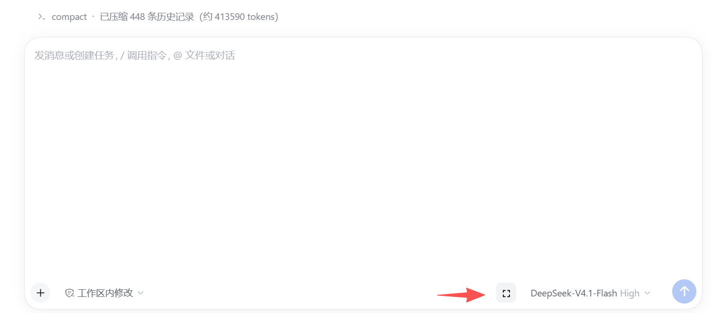

# dsh-composer-expand

English | [中文](README.zh.md)

Adds a small toggle button beside the composer **Send** action in DeepSeek Harness (`dsh`) Web.

**Default** — the composer is one line tall, and the new button sits beside Send:


**Enlarged** — click the button for a roomy, multi-line input box:



- Click the button to **enlarge the input box** (it lifts the draft's max-height cap and raises the minimum height, so even an empty box grows).
- While enlarged, **Enter inserts a newline** instead of sending; send with the **Send** button or **Ctrl/Cmd+Enter**.
- Click again to restore the normal height and normal **Enter-to-send**.
- **Shift+Enter** still inserts a newline, and IME composition is unaffected.

## Install

From GitHub (no npm publish):

```sh
dsh plugin --profile web add git+https://github.com/Iamwangli/dsh-composer-expand.git
```

From a local checkout:

```sh
dsh plugin --profile web add /path/to/dsh-composer-expand
```

Restart the `web` profile (or refresh the page) after installing.

## Usage

The button sits in the composer toolbar next to Send. Its tooltip/aria-label follows the UI language (`Enlarge input` / `Restore input`, or `放大输入框` / `收起输入框`).

## Tuning

Two constants at the top of `client.js` control the expanded size:

```js
const EXPANDED_MIN_HEIGHT = '320px'; // visible floor for an empty box
const EXPANDED_MAX_HEIGHT = '560px'; // cap for long drafts
```

## Compatibility

Developed and tested against DSH `0.2.2-rc.5`. It only uses the public `conversation.input.right` slot, the client locale service, and the composer's documented `data-composer-card` / `data-input-scroll` / `data-composer-input` hooks.

## License

MIT — see [LICENSE](LICENSE).
